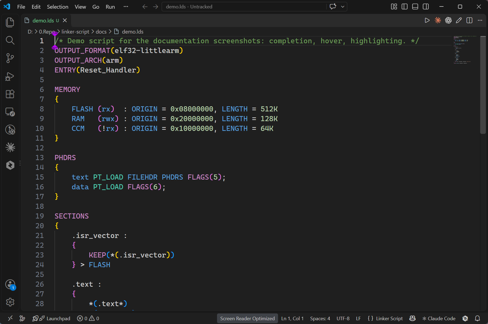
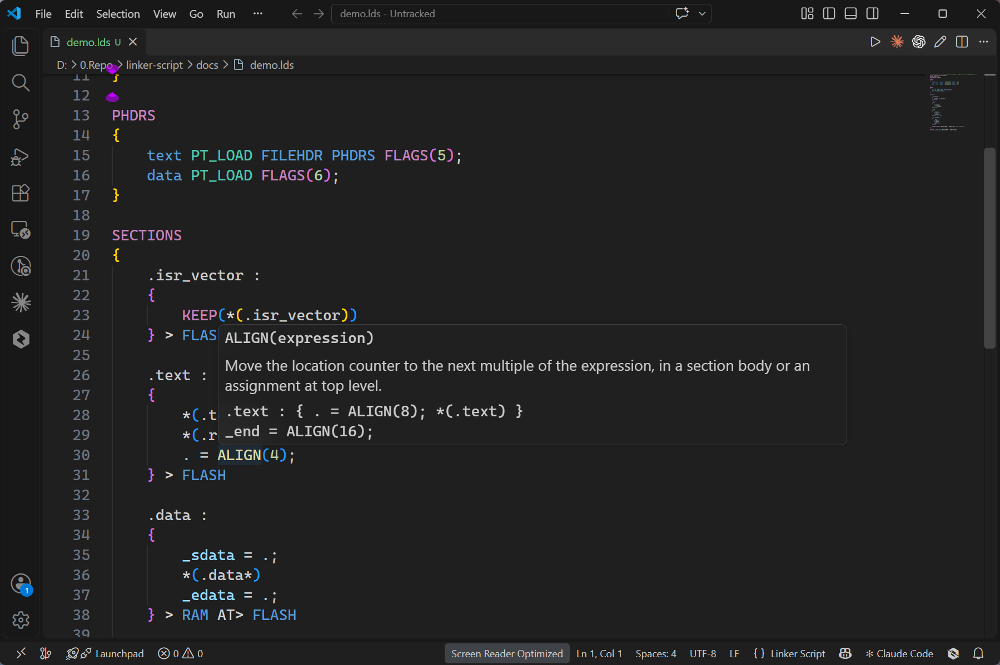
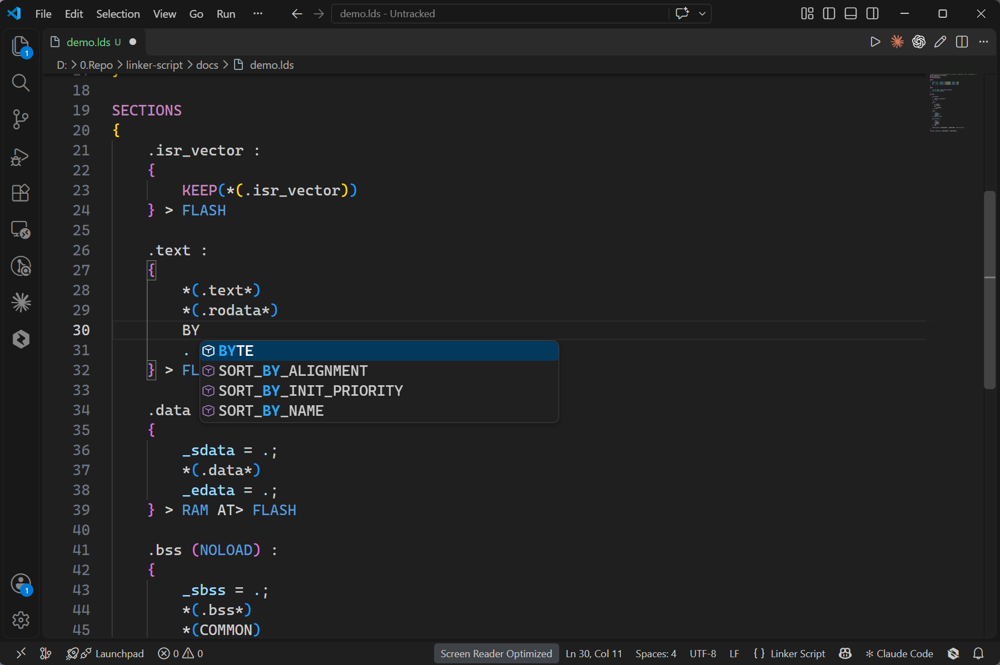

# Linker Script

Completion, hover documentation, and syntax highlighting for GNU linker script files (`.lds` and `.ld`).

## Features

- **Context-aware completion.** Each of the 84 built-in keywords is offered in the context it belongs to: commands at the top of the file, output section syntax directly inside `SECTIONS`, data commands, expression functions, the input section filters, and the `ASSERT`, `PROVIDE` and `PROVIDE_HIDDEN` commands inside an output section body, region fields and attributes inside `MEMORY`, program header types and modifiers inside `PHDRS`, version-script commands inside `VERSION`, and section descriptions inside `OVERLAY`. A keyword that takes arguments inserts a snippet with tab stops in place of them, and every item shows its one-sentence description next to the entry.
- **Safe fallback.** When the surrounding braces no longer describe the file (an unmatched `}`, an unterminated block comment, or an `INCLUDE` earlier in the file), the extension stops guessing and offers every keyword instead of a possibly wrong subset. Inside a comment or a string it offers nothing.
- **Hover documentation.** Hovering a keyword shows its signature, a one-sentence description, and a short usage example. The signature is derived from the same snippet completion inserts, so the two cannot drift apart.
- **Syntax highlighting.** Comments, strings, decimal/hex/octal numbers with `K`/`M` suffixes, commands and block keywords, expression functions, output and input section names, the location counter `.`, symbols, region markers and attributes, program header types, version nodes, and operators each get their own scope.
- **Editor behavior for the language.** `/* */` is the comment syntax, so *Toggle Line Comment* inserts a block comment; brackets and parentheses auto-close; double-clicking keeps `SORT_BY_NAME` and `.text.foo` whole; `/* #region */` and `/* #endregion */` lines are folding markers.
- **Works on a single file.** Opening `link.lds` with no folder open still activates the extension.

## Screenshots

Syntax highlighting, including `/* */` comments, section and region names, region attributes and `K`/`M`-suffixed numbers:



Hover documentation: the signature derived from the snippet, a one-sentence summary and a usage example:



Context-aware completion: inside an output section body the data commands are offered and the block keywords are not:



## Example

Paste this into a file named `link.lds` to see completion, hover, and highlighting in action. Start typing `SEC` at the top of the file, or hover `ALIGN`, `SIZEOF`, `ORIGIN` or `PROVIDE`.

```ld
/* Minimal freestanding image for a 32-bit microcontroller. */
ENTRY(_start)
OUTPUT_FORMAT(elf32-littlearm)
OUTPUT_ARCH(arm)

MEMORY
{
    FLASH (rx)  : ORIGIN = 0x08000000, LENGTH = 256K
    RAM   (rwx) : ORIGIN = 0x20000000, LENGTH = 64K
}

SECTIONS
{
    .text :
    {
        KEEP(*(.vectors))
        *(.text*)
        *(.rodata*)
        . = ALIGN(4);
    } > FLASH

    .data :
    {
        *(.data*)
    } > RAM AT> FLASH

    .bss (NOLOAD) :
    {
        *(.bss*)
        *(COMMON)
        . = ALIGN(4);
    } > RAM

    PROVIDE(__stack_top = ORIGIN(RAM) + LENGTH(RAM));
    ASSERT(SIZEOF(.text) > 0, "empty .text")
}
```

## Compatibility and coexistence

This extension contributes the language id `linker-script` and associates `.lds` and `.ld` with it. When another extension also declares those extensions, both associations exist but a file still gets exactly one language id, and VS Code takes the association registered last. That order is not documented and no setting exposes it, so either extension can end up owning the file, and installing or updating an extension can change the outcome. Another linker script extension that declares the same extensions is `squarewave.linker-script-syntax`; when it wins, the document language id is `ld`.

Both extensions can stay installed. This one also registers its completion and hover providers for the `ld` language id, so they keep working either way. What changes is highlighting: the TextMate grammar here applies only to `linker-script`, so a document claimed by the other extension is colored by that extension's grammar. To use the language and highlighting from this extension, disable the other extension, run **Change Language Mode** and pick **Linker Script** for the file, or set a durable mapping in `files.associations` (`"*.lds": "linker-script"` and `"*.ld": "linker-script"`), which takes priority over every extension's own association.

Issues caused by the other extension's behavior belong in its repository, not this one.

## Requirements

- VS Code 1.74 or newer (`engines.vscode` is `^1.74.0`).
- Files written for GNU ld or a compatible linker. The extension does not invoke the linker; it only edits and reads the script text.
- No runtime dependencies, no network access, and no file writes. Untrusted and virtual workspaces are fully supported because every feature works from the open document alone.

## Known limitations

- **No diagnostics or formatting.** The extension never builds, links, or reformats; syntax errors are not reported and indentation is left alone.
- **Completion is a keyword list, not a parser.** Items are filtered by the enclosing block, not by what is grammatically valid at that exact position, and the list is not narrowed by the typed prefix beyond the editor's own filtering. The `ld` compatibility path only exists when another extension contributes that language id.
- **Version node names are not completed.** Inside a `VERSION` block completion offers the three version-script commands `global`, `local` and `extern`, but the version node names you write are your own identifiers and get no items.
- **Hover is scope-agnostic.** A known keyword is documented wherever the cursor is, including inside comments and strings, because the word lookup deliberately ignores the block context.
- **No symbol or filename completion.** Only the 84 registered linker script keywords are completed; symbols defined in your project and files on disk are not.
- **Highlighting covers linker script syntax only.** It is not a semantic model of your link: a script that a build step preprocesses with the C preprocessor before linking (for example `gcc -E`) is colored as written.
- **No line-comment syntax.** `//` is not a comment in GNU linker scripts, so the language intentionally has no line comment; use `/* */`.

## Release Notes

See [CHANGELOG.md](CHANGELOG.md).
